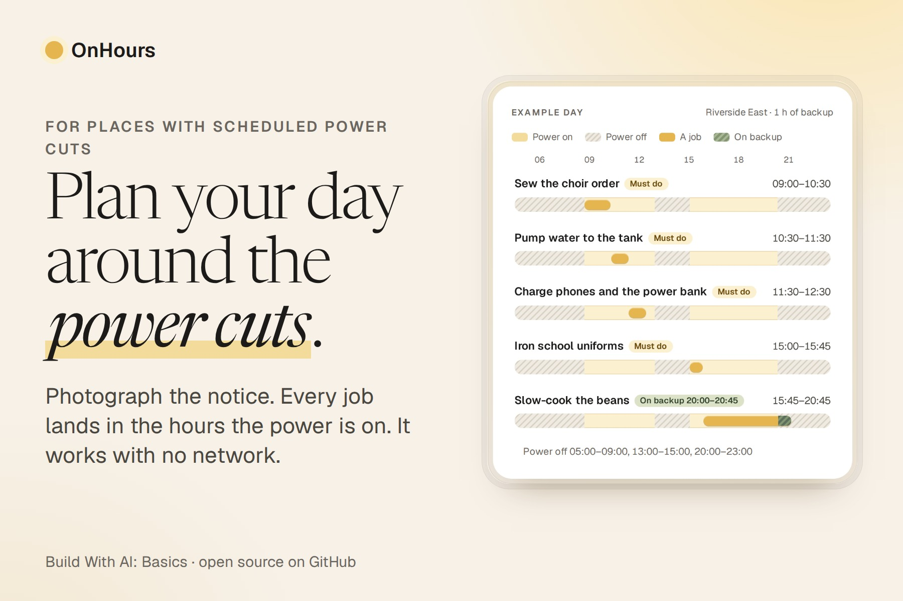

# OnHours

**Plan your day around the power cuts.** Photograph the outage notice from your group chat, or paste its text. OnHours finds your area's power cuts, fits every job that needs electricity into an unbroken stretch when the power is on, and says plainly why a job does not fit. It runs on a phone with no power and no network.



OnHours is a proof of concept built for Devpost's [Build With AI: Basics](https://learn-ai-basics.devpost.com/) with the Devpost Learn skill pack. It is open source under the MIT licence. The notice, areas and jobs in the sample data are fictional.

## What it does

1. Reads the notice. A photo (read by an AI model that can see pictures, clean or messy) or pasted text (read by an AI model, or by built-in rules that also run on the phone). Every area and its outage times appear, so you can check them against the notice.
2. Plans the day. Pick your area, set how many hours your backup battery or inverter runs, and list the jobs: how long each needs, which must happen today, which can run on backup. Jobs can be typed in plain words ("iron 45 min, pump 1 h").
3. Shows the day. A chart gives every job a bar inside the hours the power is on. A Right now card says whether the power is on or off, what is running and what comes next.
4. Explains what does not fit. "Needs 5 h in one go; the longest powered stretch left is 4 h 15 min." A job that can run on backup may cross an outage, and the plan says when to switch.
5. Works with no power and no network. After one visit the page opens offline and can be added to a phone's home screen. Your jobs, area and last notice are saved in the browser only.
6. Shares the plan. As a picture for the family chat, as a calendar file with a reminder ten minutes before every job and every cut, or as plain text.
7. Shows what moved when a notice is revised. Read a new notice for the same area and a card lists the cuts before and after, and every job that moved or no longer fits, each with its reason.

The AI only reads the notice. Placing the jobs is ordinary, tested code in [`public/planner.js`](public/planner.js), so the same notice and jobs always give the same plan.

## Run it in 30 seconds

You need [Node.js](https://nodejs.org/) 20 or newer. There are no packages to install.

```sh
git clone https://gitlab.com/ebenworks-systems/onhours.git
cd onhours
node server/index.js
```

Open http://localhost:5174, then press **Try the sample day**. The plan for Riverside East appears, with the slow-cooked beans under Didn't fit. Raise the backup to one hour (or press **Try 1 hour of backup**) and the beans fit, on backup from 20:00 to 20:45. Then open the Text tab, press Use a revised notice and Read the notice: the iron moves to 16:00 and the beans stop fitting, each with a reason. The Photo tab has two sample photos, a clean one and a messier one (Try a messier photo), which need the AI reader.

To see "Right now" at a chosen moment, add `?now=13:30` to the address. The card then says the clock is set.

## Switch on the AI reader (optional)

Without setup, built-in rules read text notices (`05:00-09:00`, `5am to 9am`, `17h00–21h00`) and the Photo tab says it needs the AI reader. Any OpenAI-compatible chat endpoint works:

```sh
export LLM_BASE_URL=https://your-provider.example/v1   # ends in /v1
export LLM_API_KEY=your-key
export LLM_MODEL=your-text-model
export LLM_VISION_MODEL=your-vision-model              # switches photo reading on
node server/index.js
```

`.env.example` lists the same names. The key stays on the server and is never sent to the browser or written to disk. If the model is slow, unreachable or answers in the wrong shape, the built-in rules take over where there is text to read, and the page says so. A photo is held in memory for one request and is not stored or logged.

## Tests

```sh
node --test
```

The tests cover the planner (the sample day to the minute, no overlaps, no job in an outage unless it runs on backup, backup never over budget, the same plan every time, and a few hundred random days), the comparison of two plans behind "what moved", "Right now", plain-words jobs, the calendar file, the saved household, the service worker's file list and the manifest, the built-in notice reader, the AI reader's reply check, its handling of a photo (good reply, bad reply, reply cut off, no outage times, switched off) and the server's routes and limits.

## How it fits together

| Path | What it does |
| --- | --- |
| `server/index.js` | Serves the page, `GET /api/status` and `POST /api/read-notice` (text up to 16 KB, a shrunk photo up to 3 MB) |
| `server/read-notice.js` | Asks the model for JSON, checks the reply, falls back to the rules |
| `public/rules.js` | The built-in notice reader, shared by the server and the page |
| `public/planner.js` | `planDay()`, `planToText()` and `diffPlans()` (what moved between two plans), shared by the page and the tests |
| `public/now.js`, `public/jobtext.js` | The Right now card and plain-words jobs |
| `public/app.js`, `public/draw.js`, `public/jobs.js` | Page behaviour, the day chart, the jobs editor |
| `public/store.js`, `public/sw.js`, `public/manifest.webmanifest` | The saved household, the offline layer, installing on a home screen |
| `public/share.js`, `public/card.js`, `public/ics.js` | Copy, the plan picture, the calendar file |
| `devpost/` | The planning documents: [scope](devpost/scope.md), [product requirements](devpost/prd.md), [technical spec](devpost/spec.md), [build checklist](devpost/checklist.md) and the [version 2 upgrade plan](devpost/UPGRADE-PLAN.md) |
| `submission/` | The demo video and captions, its script and build steps, the gallery images and the Devpost text |
| `tools/` | How the demo video, the sample photo, the icons and the gallery images are made |

Fonts: Newsreader and Geist, under the SIL Open Font License (`public/fonts/`).

With the app running, `node tools/check-journey.cjs` walks the whole journey in a headless browser at 1280 and 390 pixels wide, and `node tools/check-acceptance.cjs` checks every acceptance line of the product requirements, including with the AI reader off, failing and offline. Both need `playwright-core`; see `submission/BUILD-VIDEO.md`.

## How it was built

Plan first, with the Devpost Learn skills: scope, product requirements, technical spec, then a build checklist of slices, each tested and committed before the next. Version 1 (a pasted notice becomes a plan) was built on 16 October 2026; version 2 (photo, backup power, offline, sharing, a new design) was planned again with the same skills on 20 October 2026, and a sixth slice (what moved when a notice is revised) was added on 21 October 2026 after three simulated judges read the finished version. The git history shows all three rounds. [`PROGRESS.md`](PROGRESS.md) is the log.

## Licence

OnHours is released under the MIT License (see [`LICENSE`](LICENSE)). The fonts keep their own SIL Open Font License.

## Re-installing the skill pack

The Devpost Learn skills are not stored in this repository. To run them again in a checkout:

```sh
npx skills add challengepost/learn-ai-basics --all -y
```

`skills-lock.json` records the versions used.
